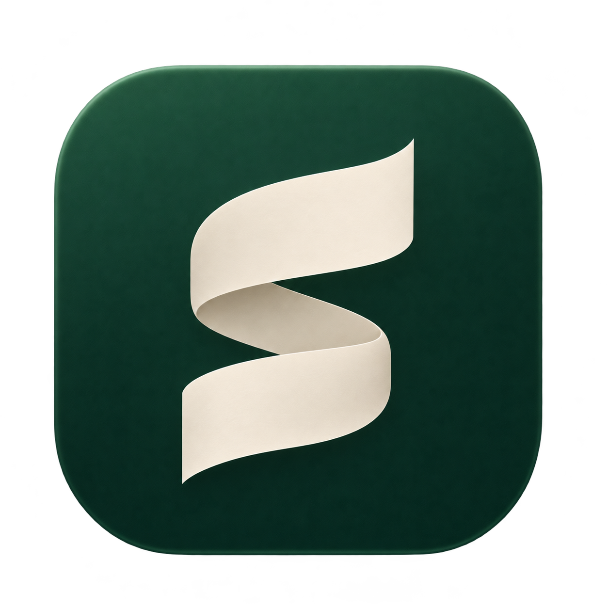
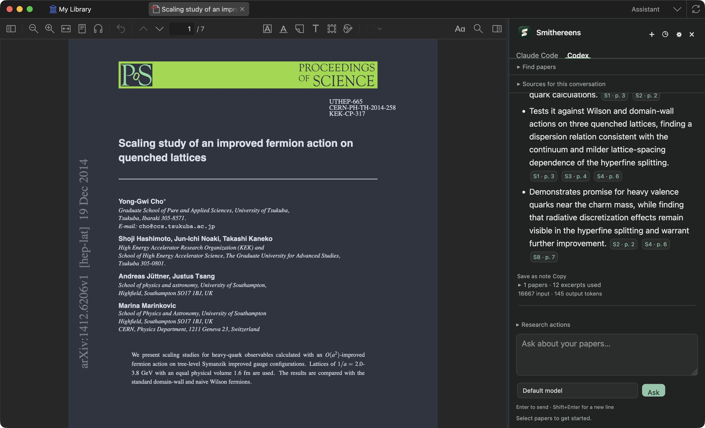

<p align="center">
  
</p>
<h1 align="center">Smithereens</h1>
<p align="center"><strong>Your research library. A conversation beside every paper.</strong></p>
<p align="center">A Zotero-based desktop workspace for reading, comparing, and understanding research with your existing Codex or Claude Code subscription.</p>
<p align="center">
  <a href="https://github.com/Aeshan-Rosa/smithereens/actions/workflows/research.yml"></a>
  <a href="COPYING"></a>
  
  
</p>
<p align="center"><a href="#getting-started">Get started</a> · <a href="#build-from-source">Build</a> · <a href="docs/implementation.md">Technical guide</a> · <a href="#status-and-limits">Status</a></p>



## A library that can talk back

Keep Zotero's paper saving, collections, tags, attachment storage, citations, notes, and original PDF viewer. Add a quiet assistant beside your work, with visible sources and page links that take you back to the evidence.

| Work | What you can do |
| --- | --- |
| **Collect** | Import PDFs, save by DOI, use Zotero's Connector, or discover papers through Crossref. |
| **Read** | Use Zotero's original PDF/EPUB reader, annotations, search, and navigation. |
| **Ask** | Chat about one paper, selected papers, a collection, or matching papers from your library. |
| **Compare** | Generate summaries, comparisons, evidence tables, claim checks, screening decisions, and literature drafts. |
| **Verify** | Follow source chips to PDF pages and inspect the supporting excerpts. |
| **Keep** | Save conversations locally and turn useful answers into editable Zotero notes. |

The Folio identity pairs an ivory folded-paper **S** with forest green. The interface uses 16px chat text, restrained controls, a resizable sidebar, and system light/dark appearance.

## Getting started

1. Open **Smithereens.app** from Applications (or from your local build).
2. Sign in to a supported local CLI: `codex login` or `claude auth login`.
3. Open assistant settings, choose the provider, and select **Check connection**. No API key is required.
4. Add papers through Zotero. Select them and click **Selected**, or open a PDF and choose **Open PDF**.
5. Ask a question. Follow a citation to its page, or choose **Save as note** to keep the answer.

**Cmd/Ctrl+Shift+A** toggles the assistant. Type **@** followed by part of a paper title to add it to a conversation. Model names and per-conversation research instructions are optional.

Smithereens uses its own profile and does not automatically adopt or migrate an existing Zotero database. When using the browser Connector, run only one Zotero-compatible desktop app at a time.

## How the assistant works

Zotero's document worker extracts page-aware text. Smithereens selects a bounded set of relevant excerpts, balances them across papers, and sends those excerpts and your question to the provider you choose. Answers carry clickable evidence references, and changed PDFs are detected before opening older citations.

- **Existing subscriptions:** Codex uses your ChatGPT login; Claude Code uses your first-party Claude subscription login. Subscription limits apply.
- **Explicit context:** Up to 24 pinned or retrieved papers and a 64,000-character excerpt budget per answer. Collection/library search uses Zotero's indexed search.
- **Local history:** Conversations stay in the Smithereens profile. Questions, excerpts, and bounded conversation context are sent to the selected provider.
- **Restricted requests:** Provider processes use an isolated working directory with coding tools and integrations disabled. API-key overrides are removed from their environment.
- **Visible uncertainty:** Unavailable PDFs and abstract-only sources are labeled. The assistant is instructed to distinguish reported findings from interpretation.

A source link establishes where an excerpt came from; it does not independently validate the model's interpretation. The original page remains one click away.

## Build from source

The packaged app has been built and tested on Apple Silicon macOS. Install Node.js 22, Git, and Git LFS, then:

```sh
git clone --recurse-submodules https://github.com/Aeshan-Rosa/smithereens.git
cd smithereens
git lfs install
git lfs pull
npm ci
app/scripts/fetch_xulrunner -p m
scripts/package-mac.sh
```

Open `dist/Smithereens.app`. For an isolated development library inside this checkout, run `scripts/run-dev.sh`. Rebuild the icon family with `scripts/build-branding.sh`.

To install a local build, quit Smithereens and copy `dist/Smithereens.app` into `/Applications`. Open that copy, then use its Dock menu: **Options → Keep in Dock**. Normal launches keep the library and chat history in the Smithereens profile under `~/Library/Application Support/Smithereens`, independently of this checkout. The development profile is separate; copying the app alone does not transfer its library.

The source retains Zotero's other platform build scripts; Windows and Linux packages have not been verified for Smithereens. Local macOS builds are ad-hoc signed, not notarized. Build output, local libraries, credentials, and chat history are excluded from Git.

## Validation

```sh
# Fast tests; these also run in GitHub Actions
node --test test/research-core.test.cjs

# Native desktop integration and original reader regression tests
test/runtests.sh research reader

# Optional: tiny synthetic comparison using both signed-in subscriptions
SMITHEREENS_LIVE_TEST=all test/runtests.sh -f research
# Use codex or claude instead of all to test only one provider
```

**Verified locally:** 21 desktop/integration checks and 7 standalone checks passed. Real Codex and Claude subscription requests compared two synthetic papers with citations. Paper import, source-linked PDF navigation, saved notes, and restored conversations were also verified. macOS Keychain-backed Claude sign-in requires a normal desktop process; a restricted shell can incorrectly report that it is signed out.

## Status and limits

This is an initial working desktop build. Deep review is a bounded response over retrieved excerpts, not an autonomous web-research agent. Library search is not an exhaustive systematic review. Scanned PDFs need a searchable text layer; automatic OCR and visual interpretation of figures/equations are planned. The original viewer can still display and annotate those documents.

Upstream automatic app updates are disabled to preserve the fork. The upstream dependency lockfile is retained and has known npm audit findings; a dependency audit is needed before public binary distribution.

## Project structure

```text
chrome/content/zotero/research/   Evidence selection, providers, persistence
chrome/content/zotero/researchPane.js
chrome/skin/default/zotero/research.css
app/branding/                   Approved Folio artwork
scripts/                        Branding, packaging, development launch
test/tests/researchTest.js       Native integration tests
test/research-core.test.cjs      Fast evidence/protocol tests
docs/                           Screenshots and implementation notes
```

## Upstream, attribution, and license

Smithereens incorporates the Zotero 10.0.9 source snapshot at [`0f25aca`](https://github.com/zotero/zotero/commit/0f25aca5e5e087fa44404c134fd384e2aeca4eda). Its reader and document-worker submodules remain pinned to that release. Existing copyright and license notices are preserved.

Licensed under [AGPL-3.0-or-later](COPYING). This is an independent modified build, not an official Zotero release. Zotero is a trademark of the Corporation for Digital Scholarship. Report Smithereens-specific issues in [this repository](https://github.com/Aeshan-Rosa/smithereens/issues).
